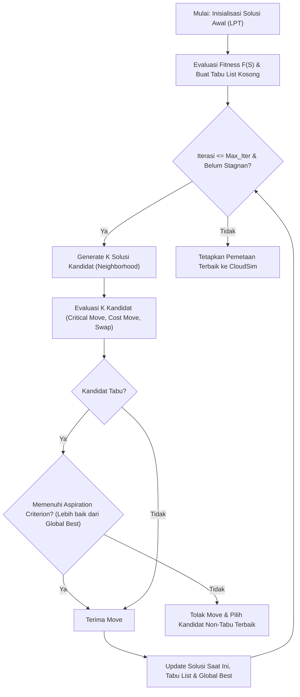
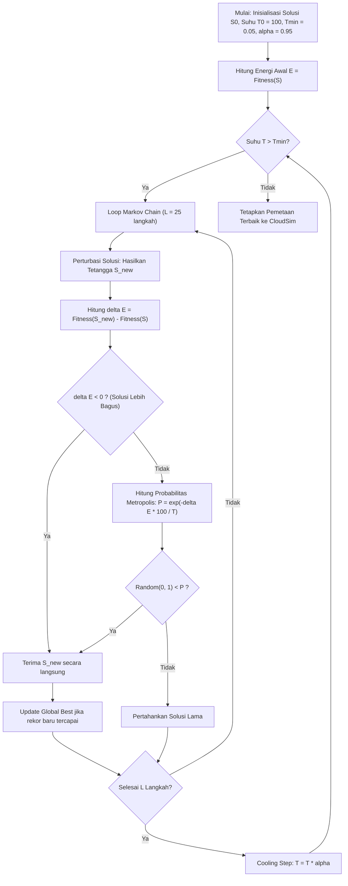

# Simulasi Penjadwalan Task Metaheuristik di CloudSim
## Tabu Search (TS) vs Simulated Annealing (SA)

Proyek simulasi komparasi dua algoritma **Metaheuristik** untuk *Task Scheduling* pada lingkungan komputasi awan heterogen menggunakan **CloudSim 3.0.3**, diuji pada dataset nyata **GoCJ (Google Cloud Jobs)** dan **Dataset Sintetik (100 s/d 10.000 task)**.

---

## Daftar Isi
1. [Latar Belakang & Problem Formulation](#1-latar-belakang--problem-formulation)
2. [Arsitektur Datacenter dan Virtual Machine](#2-arsitektur-datacenter-dan-virtual-machine)
3. [Dataset Pengujian](#3-dataset-pengujian)
4. [Fungsi Objektif (Fitness Function)](#4-fungsi-objektif-fitness-function)
5. [Algoritma 1: Tabu Search (TS)](#5-algoritma-1-tabu-search-ts)
6. [Algoritma 2: Simulated Annealing (SA)](#6-algoritma-2-simulated-annealing-sa)
7. [Metrik Evaluasi](#7-metrik-evaluasi)
8. [Struktur Proyek](#8-struktur-proyek)
9. [Cara Menjalankan Simulasi](#9-cara-menjalankan-simulasi)
10. [Panduan Pembuatan Slide Presentasi](#10-panduan-pembuatan-slide-presentasi)

---

## 1. Latar Belakang & Problem Formulation

Pada tugas sebelumnya, algoritma heuristik **Longest Processing Time (LPT)** telah diimplementasikan. Meskipun LPT cepat, algoritma tersebut bersifat *greedy* deterministik:
- **Kelemahan Heuristik LPT**: Hanya fokus mencari waktu tercepat tanpa mempertimbangkan tarif sewa VM. Akibatnya, LPT cenderung membebani VM Compute-Intensive yang bertarif mahal (150 G$/s), menyebabkan **Total Cost membengkak**, dan mudah terjebak dalam *local optima*.
- **Solusi Metaheuristik**:
  1. **Tabu Search (TS)**: Menggunakan memori jangka pendek (*Tabu List*) dan kriteria aspirasi untuk mengeksplorasi ruang solusi secara terarah tanpa terjebak dalam siklus pengulangan (*cycling*).
  2. **Simulated Annealing (SA)**: Mengadopsi prinsip pendinginan termodinamika logam dengan probabilitas penerimaan *Metropolis* untuk melompati *local optima* pada suhu tinggi dan melakukan konvergensi halus pada suhu rendah.

---

## 2. Arsitektur Datacenter dan Virtual Machine

Lingkungan komputasi awan heterogen dibangun menggunakan spesifikasi berikut:

### Host Fisik (2 Datacenter, 10 Host)
| Tipe Server | Host ID | Jumlah | Core | MIPS/Core | RAM | Storage | Bandwidth |
|---|---|---|---|---|---|---|---|
| **High Performance** | 0 – 3 | 4 | 8 core | 3.000 MIPS | 32 GB | 1 TB | 10 Gbps |
| **Standard** | 4 – 9 | 6 | 4 core | 1.500 MIPS | 16 GB | 500 GB | 1 Gbps |

### Mesin Virtual / VM (16 VM Heterogen)
| Jenis VM | ID VM | Jumlah | vCPU | MIPS/vCPU | RAM | Bandwidth | Biaya Sewa |
|---|---|---|---|---|---|---|---|
| **Compute-Intensive** | 0 – 3 | 4 | 2 vCPU | 2.500 MIPS | 8 GB | 1 Gbps | **150 G$/s** |
| **Standard** | 4 – 9 | 6 | 1 vCPU | 1.500 MIPS | 4 GB | 250 Mbps | **40 G$/s** |
| **Light-weight** | 10 – 15 | 6 | 1 vCPU | 800 MIPS | 2 GB | 250 Mbps | **18 G$/s** |

- Kebijakan penempatan VM ke Host: `VmAllocationPolicySimple` (menyebarkan VM ke host dengan core bebas terbanyak).
- VM Compute-Intensive otomatis ditempatkan pada Host High Performance karena core Host Standard (1.500 MIPS) tidak mencukupi kebutuhan 2.500 MIPS VM tersebut.

---

## 3. Dataset Pengujian

Pengujian dilakukan secara komprehensif pada **dua kategori dataset**:

### A. Dataset GoCJ (Google Cloud Jobs)
- Berisi 19 file: `GoCJ_Dataset_100.txt` s/d `GoCJ_Dataset_1000.txt` (kenaikan 50 task).
- Diturunkan dari jejak workload Google cluster traces dengan variasi ukuran job yang dinamis (hingga > 350.000 MI).

### B. Dataset Sintetik Deterministik (30/40/30)
- Dibuat otomatis oleh `DatasetGenerator.java` dengan seed tetap (`42 + jumlah_task`).
- Ukuran: 100, 200, ..., 1.000 task (komparasi apple-to-apple) dan skala masif 2.000 s/d 10.000 task (*stress-testing* konvergensi metaheuristik).
- **Distribusi Panjang Task**:
  - **Kecil (30%)**: 1.000 – 10.000 MI
  - **Sedang (40%)**: 10.001 – 30.000 MI
  - **Besar (30%)**: 30.001 – 50.000 MI

---

## 4. Fungsi Objektif (Fitness Function)

Untuk memecahkan trade-off antara kecepatan eksekusi dan efisiensi biaya sewa VM, kami menggunakan **Bi-Objective Weighted Fitness Function**:

$$\text{Minimize } F(S) = w_1 \cdot \left(\frac{\text{Makespan}(S)}{\text{Makespan}_{\text{ref}}}\right) + w_2 \cdot \left(\frac{\text{Cost}(S)}{\text{Cost}_{\text{ref}}}\right)$$

- $w_1 = 0.5$ (Bobot performa waktu)
- $w_2 = 0.5$ (Bobot efisiensi biaya)
- $\text{Makespan}_{\text{ref}}$ dan $\text{Cost}_{\text{ref}}$: Nilai acuan dari solusi awal untuk normalisasi.
- **Tujuan**: Nilai $F(S)$ yang semakin **kecil** menunjukkan kualitas jadwal yang semakin optimal.

---

## 5. Algoritma 1: Tabu Search (TS)

Tabu Search adalah algoritma metaheuristik berbasis *local search* yang memanfaatkan struktur memori untuk mencegah pencarian kembali ke solusi yang baru saja dikunjungi.



### Langkah-Langkah Algoritma Tabu Search:
1. **Representasi Solusi**: Array integer satu dimensi berukuran $N$ (jumlah task), di mana `solution[i] = vm_id`.
2. **Inisialisasi**: Solusi awal diisi menggunakan alokasi LPT agar pencarian dimulai dari titik yang sudah cukup baik (*warm start*).
3. **Neighborhood Operators (Pencarian Tetangga)**:
   - **Critical VM Move (50%)**: Mengidentifikasi VM *bottleneck* (VM dengan waktu selesai tertinggi/penentu makespan), lalu memindahkan salah satu task-nya ke VM lain.
   - **Cost Reduction Move (25%)**: Memindahkan task dari VM Compute-Intensive (mahal) ke VM Standard atau Light-weight (hemat).
   - **Swap Move (25%)**: Menukar penugasan dua task antar VM berbeda.
4. **Tabu Matrix & Tenure**:
   - Struktur `tabuUntil[task_id][orig_vm]` mencatat batas iterasi larangan.
   - Jika suatu task dipindahkan dari VM $A$ ke VM $B$, pemindahan kembali ke VM $A$ dilarang selama durasi `tabuTenure = 15` iterasi.
5. **Kriteria Aspirasi (Aspiration Criterion)**:
   - Jika suatu perpindahan berstatus *tabu* tetapi menghasilkan nilai $F(S)$ yang memecahkan rekor terbaik global (*Global Best*), status *tabu* dicabut (*override*) dan solusi diterima.
6. **Kondisi Berhenti**: Mencapai `maxIterations = 150` atau jika solusi tidak mengalami perbaikan selama 40 iterasi beruntun.

---

## 6. Algoritma 2: Simulated Annealing (SA)

Simulated Annealing meniru proses pendinginan logam cair menjadi kristal padat dengan energi minimum.



### Langkah-Langkah Algoritma Simulated Annealing:
1. **Inisialisasi Parameter**:
   - Suhu Awal ($T_0$): `100.0`
   - Suhu Minimum ($T_{min}$): `0.05`
   - Laju Pendinginan ($\alpha$): `0.95` (*geometric cooling*)
   - Panjang Rantai Markov ($L$): `25` iterasi per tingkat suhu.
2. **Perturbasi Solusi**:
   - Mengubah alokasi satu task pada VM kritis atau menukar dua task antar VM secara acak.
3. **Kriteria Penerimaan Metropolis**:
   - Hitung selisih energi: $\Delta E = F(S_{\text{new}}) - F(S_{\text{current}})$.
   - Jika $\Delta E < 0$ (solusi lebih optimal): **Pasti diterima**.
   - Jika $\Delta E \ge 0$ (solusi lebih buruk): Diterima dengan probabilitas:
     $$P = \exp\left(-\frac{\Delta E \times 100}{T}\right) > \text{random}(0, 1)$$
     *(Memungkinkan algoritma melompat keluar dari jebakan local optima pada suhu awal).*
4. **Penurunan Suhu**:
   - Setelah setiap $L$ iterasi, suhu diturunkan: $T_{k+1} = \alpha \times T_k$.
5. **Kondisi Berhenti**: Suhu mencapai $T < T_{min}$.

---

## 7. Metrik Evaluasi

Hasil simulasi CloudSim diukur secara seragam menggunakan 6 metrik utama:

| Metrik | Definisi & Rumus | Satuan | Makna Kualitas |
|---|---|---|---|
| **Makespan** | $\max_{i} (\text{FinishTime}_i)$ | Detik (s) | Semakin kecil semakin cepat |
| **Total Cost** | $\sum_{j} (\text{FinishTime}_j \times \text{Tarif}_j)$ | G$ | Semakin kecil semakin hemat |
| **Resource Utilization** | $\frac{\sum \text{CPUTime}}{\sum \text{vCPU} \times \text{Makespan}} \times 100\%$ | % | Semakin tinggi semakin efisien |
| **Degree of Imbalance** | $\frac{T_{\max} - T_{\min}}{T_{\text{avg}}}$ | - | Semakin kecil beban semakin seimbang |
| **Throughput** | $\frac{\text{Jumlah Task Selesai}}{\text{Makespan}}$ | task/s | Semakin besar semakin produktif |
| **Scheduling Time** | Waktu eksekusi algoritma menentukan jadwal | ms | Mengukur kecepatan konvergensi |

---

## 8. Struktur Proyek

```text
SOKA-metaheurictic/
├── Compile Meta.txt                     # Petunjuk compile & eksekusi cepat
├── pom.xml                              # Konfigurasi Maven & CloudSim
├── lib/
│   └── cloudsim-3.0.3.jar               # Library simulator CloudSim
├── data/
│   ├── GoCJ_Dataset_100.txt ... 1000.txt# Dataset Google Cloud Jobs
│   └── synthetic/                       # Dataset sintetik 30/40/30 (100 - 10.000 task)
├── results/
│   ├── hasil_komparasi.csv              # Rangkuman rata-rata 3 run (Tabu Search vs Simulated Annealing)
│   ├── hasil_komparasi_runs.csv         # Data mentah setiap run
│   ├── dataset_stats.csv                # Statistik panjang task per dataset
│   ├── host_vm_placement.csv            # Pemetaan alokasi VM ke Host
│   ├── vm_placement_detail.csv          # Detail spesifikasi per VM
│   └── grafik/                          # Grafik perbandingan visual TS vs SA (PNG)
├── scripts/
│   └── plot_comparison.py               # Script matplotlib untuk plotting komparasi TS vs SA
└── src/main/java/com/cloudsim/meta/
    ├── DatacenterFactory.java           # Setup 2 datacenter & 10 host
    ├── VmFactory.java                   # Setup 16 VM (Compute, Standard, Light)
    ├── CloudletGenerator.java           # Parser file dataset menjadi Cloudlet
    ├── DatasetGenerator.java            # Generator dataset sintetik 30/40/30
    ├── DatasetStats.java                # Statistik deskriptif dataset
    ├── SchedulingMetrics.java           # Perhitungan metrik standar CloudSim
    ├── SolutionEvaluator.java           # Evaluator fitness analitis cepat
    ├── TabuSearchScheduler.java         # Metaheuristik 1: Tabu Search
    ├── SimulatedAnnealingScheduler.java # Metaheuristik 2: Simulated Annealing
    └── Main.java                        # Entry Point: eksekusi komparasi seluruh dataset
```

---

## 9. Cara Menjalankan Simulasi

Prasyarat:
- Java JDK 8 atau JDK 11 (diuji pada OpenJDK 11).
- Python 3 dengan pustaka `matplotlib` untuk grafik.

### Langkah 1: Compile Program (PowerShell)
```powershell
if (!(Test-Path "target\classes")) { New-Item -ItemType Directory -Path "target\classes" -Force }
javac -cp "lib\cloudsim-3.0.3.jar" -d target\classes (Get-ChildItem -Path "src\main\java\com\cloudsim\meta\*.java").FullName
```

### Langkah 2: Jalankan Simulasi
```powershell
java -cp "target\classes;lib\cloudsim-3.0.3.jar" com.cloudsim.meta.Main
```

### Langkah 3: Hasilkan Grafik Komparasi
```powershell
python scripts/plot_comparison.py
```
Grafik visual akan tersimpan di folder `results/grafik/` dalam format PNG beresolusi tinggi.

---

## 10. Panduan Pembuatan Slide Presentasi

Gunakan panduan berikut sebagai acuan penyusunan slide presentasi kelompok:

* **Slide 1: Judul Presentasi**
  - Judul: *Optimasi Task Scheduling Komputasi Awan Heterogen: Komparasi Metaheuristik Tabu Search (TS) vs Simulated Annealing (SA) Menggunakan CloudSim*
  - Nama Anggota Kelompok & Mata Kuliah Sistem Komputasi Awan (SOKA).
* **Slide 2: Problem Statement & Latar Belakang**
  - Tantangan penjadwalan task independen pada VM heterogen dengan spesifikasi dan tarif sewa berbeda.
  - Alasan memilih Metaheuristik: Mampu menyelesaikan masalah optimasi kombinatorial NP-hard dengan fungsi objektif multi-kriteria secara efektif.
* **Slide 3: Arsitektur Cloud & Fungsi Objektif**
  - Datacenter dengan 10 Host dan 16 VM (Compute-Intensive, Standard, Light-weight).
  - Bi-Objective Fitness Function: Menyeimbangkan waktu selesai (*Makespan*) dan efisiensi biaya sewa VM (*Total Cost*):
    $$F(S) = 0.5 \times \frac{\text{Makespan}}{\text{RefMakespan}} + 0.5 \times \frac{\text{Cost}}{\text{RefCost}}$$
* **Slide 4: Langkah Algoritma 1 — Tabu Search (TS)**
  - Representasi solusi: array pemetaan task ke VM.
  - Neighborhood moves: Critical VM Move (mengatasi bottleneck), Cost Move (mengurangi biaya), dan Swap Move.
  - Memori Tabu: Tabu List berukuran `tenure = 15` iterasi untuk mencegah perulangan (*cycling*).
  - *Aspiration Criterion*: Memperbolehkan langkah tabu jika menghasilkan rekor baru (*Global Best*).
* **Slide 5: Langkah Algoritma 2 — Simulated Annealing (SA)**
  - Parameter: Suhu awal $T_0 = 100.0$, laju pendinginan $\alpha = 0.95$, suhu minimum $T_{min} = 0.05$.
  - Panjang rantai Markov $L = 25$ iterasi per tingkat suhu.
  - Perturbasi acak dan Kriteria Penerimaan Metropolis ($P = \exp(-\Delta E / T)$) untuk melompati *local optima*.
* **Slide 6: Dataset & Skenario Pengujian**
  - Dataset nyata GoCJ (Google Cloud Jobs, 100–1.000 task).
  - Dataset sintetik 30/40/30 (Kecil, Sedang, Besar, hingga 10.000 task).
  - Masing-masing dataset dijalankan 3 kali (*repeats*) untuk memvalidasi stabilitas performa.
* **Slide 7: Analisis Komparasi — Makespan & Throughput (TS vs SA)**
  - Tampilkan grafik `komparasi_makespan.png` dan `komparasi_throughput.png`.
  - Analisis: Tabu Search cenderung menghasilkan Makespan sedikit lebih cepat pada dataset berukuran kecil–sedang karena eksplorasi terfokus pada VM *bottleneck*. Pada ukuran masif, kedua algoritma menunjukkan konvergensi yang sangat kompetitif.
* **Slide 8: Analisis Komparasi — Total Cost & Resource Utilization (TS vs SA)**
  - Tampilkan grafik `komparasi_total_cost.png` dan `komparasi_utilization.png`.
  - Analisis: Tabu Search dan Simulated Annealing sama-sama mampu mempertahankan pemanfaatan CPU tinggi (>97–99%), dengan Simulated Annealing sering kali menemukan konfigurasi biaya sewa yang sangat ekonomis melalui penerimaan solusi probabilistik.
* **Slide 9: Analisis Komparasi — Degree of Imbalance & Waktu Konvergensi (Scheduling Time)**
  - Tampilkan grafik `komparasi_imbalance.png` dan `komparasi_scheduling_time.png`.
  - Analisis: Tabu Search unggul dalam keseimbangan beban (Degree of Imbalance lebih rendah mendekati 0), sementara Simulated Annealing menawarkan waktu komputasi penjadwalan yang sangat konsisten di setiap siklus pendinginan.
* **Slide 10: Kesimpulan & Rekomendasi**
  - Karakteristik TS: Sangat kuat dalam *intensification* (perbaikan lokal terarah pada VM kritis).
  - Karakteristik SA: Sangat kuat dalam *diversification* (menjelajahi ruang solusi yang luas tanpa mudah terjebak).
  - Rekomendasi implementasi pada sistem cloud nyata berdasarkan karakteristik beban kerja.
